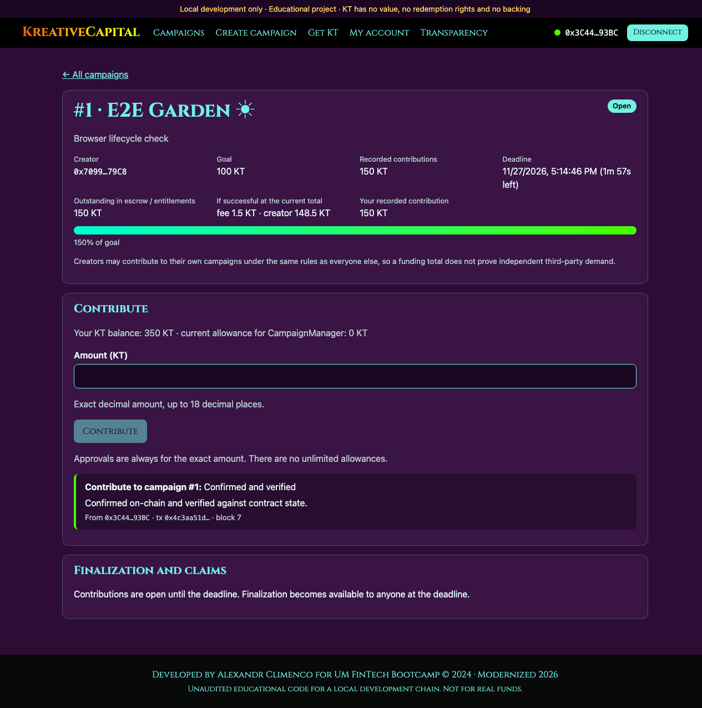
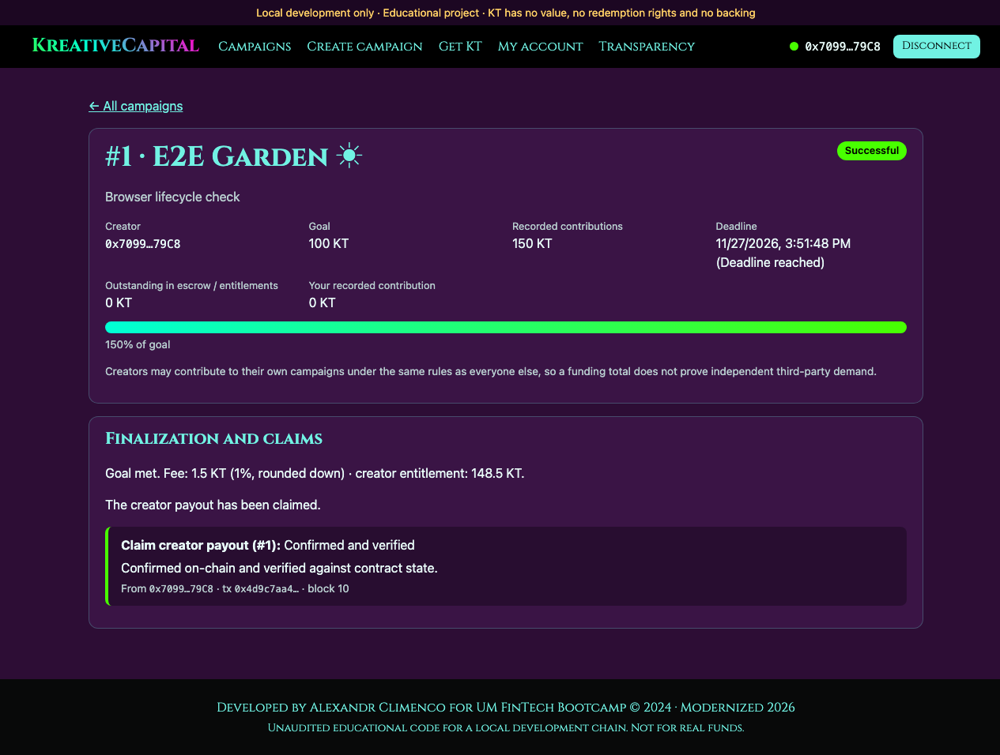
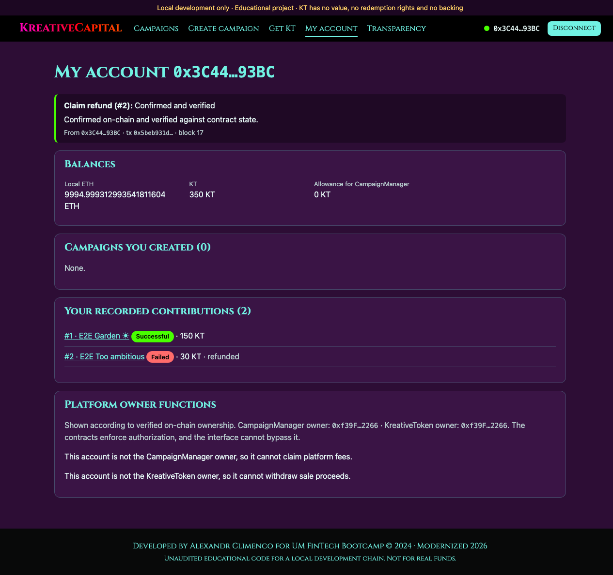
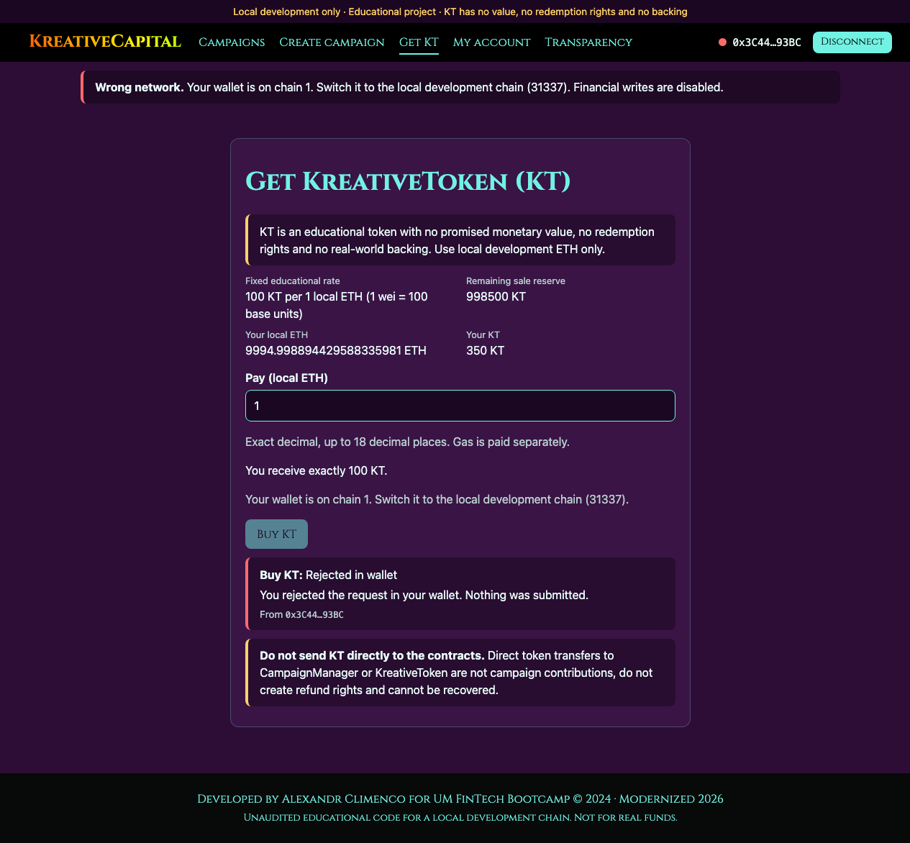

# KreativeCapital

[](https://github.com/AlexC3105/KreativeCapital/actions/workflows/ci.yml)

**KT-denominated crowdfunding on a local Ethereum development chain:**
- contributions are held in escrow
- a 1% platform fee applies only when a campaign succeeds
- every contributor gets a full refund when a campaign fails.

> **Educational, unaudited project for a local development chain only.** It is not production
> software, has not been deployed to any public network, and handles no real funds. KT has no
> value, no redemption rights and no backing.

> **About this repository.** This is the public edition of KreativeCapital, my 2024 University
> of Miami FinTech Bootcamp capstone, modernized in 2026 with AI assistance. It was published
> with a fresh Git history. The original 2024 code and the full development history are kept
> privately.



## About the project

KreativeCapital started as my solo **final capstone project for the University of Miami FinTech
Bootcamp (2024)**. The 2024 version included:
- an ERC-20 token
- crowdfunding contracts
- a React frontend with a Three.js hero
- a presentation.

In **2026** I modernized it into a coherent, tested application with **AI assistance (Claude
Code)**. I directed and reviewed the work in stages, and every architectural decision and
stage acceptance was mine. What the original did, what it did not do, and what changed are in
[docs/project-history.md](docs/project-history.md).

## What you can do

The homepage opens with three **Example Campaigns**: an active, a successful and a failed
campaign, so visitors can see the lifecycle without a wallet or a running chain. They are static,
clearly labelled demonstration cards. They are never on-chain, never counted in live figures and
offer no actions. Real campaigns appear separately under **Live Campaigns**.

- **Get KT:** buy educational KT from the token's fixed reserve with local ETH (100 KT per ETH).
- **Create a campaign:** set a goal (KT), a duration (60 s – 365 days), a name and a
  description.
- **Contribute:** approve the exact amount, then contribute before the deadline.
- **Finalize:** anyone can finalize a campaign once its deadline has passed.
- **Settle:**
  - on success, the creator claims the total minus a 1% fee, and the owner claims the fees
  - on failure, each contributor reclaims exactly what they contributed.
- **Monitor:** the **Transparency** page shows deployment verification, recorded liabilities
  against the actual balance, and token sale accounting.

## How it works

```
Browser (React + Vite) ──JSON-RPC──► Hardhat node 127.0.0.1:8545 (chain 31337)
   │  wallet via EIP-6963                ├─ KreativeToken    fixed 1,000,000 KT, contract-held sale reserve
   │  verifies the deployment            └─ CampaignManager  campaigns, escrow, pull-based claims,
   └─ reads the local manifest                               liability ledger, solvency guard
```

**Campaign lifecycle:**

```
Open ──deadline──► Awaiting finalization ──finalize (anyone)──► Successful → creator payout + 1% fee
                                                            └─► Failed     → full refunds
```

**Key safeguards:**
- **Exact accounting.** Contributions are recorded only when exactly the stated amount arrives.
  The frontend uses integer (`bigint`) arithmetic only.
- **Pull-based settlement.** Each payout goes to the entitled caller, once.
- **Liability ledger and solvency guard.** Recorded obligations must be covered by the actual
  balance. Otherwise contributions and claims pause automatically, with no administrator
  override.
- **Narrow owner powers.** The owner can claim earned fees and recorded sale proceeds only:
  no escrow withdrawal, outcome changes, minting, pausing or upgrades. Renouncing ownership is
  disabled.
- **Verified writes.** Before every transaction the app re-checks the chain, the genesis block
  and the deployed bytecode against the compiled contracts.
  - An account or network change in the wallet disables writes until the new context is
    verified. An action started under the previous context is refused, never carried over.
  - Requests are pinned to the verified account, contract and chain 31337.

  Success is shown only when the mined transaction matches the request and the receipt, the
  emitted event and the contract state agree. Anything uncertain is shown as *Unknown*.
- **Local only.** No analytics, telemetry, CDN or remote fonts. The app never asks for keys or
  seed phrases.

Details:
- [architecture](docs/architecture.md)
- [financial model](docs/financial-model.md)
- [security notes](docs/security.md).

## Technology

| Area | Stack |
|---|---|
| Contracts | Solidity 0.8.24, OpenZeppelin Contracts 4.9.6, Hardhat 2.30 |
| Frontend | React 18, React Router 6, Vite 6, ethers 6, Three.js (optional WebGL hero) |
| Testing | Mocha/Chai (Hardhat), Vitest + Testing Library, headless Chrome via DevTools protocol, axe-core |
| Tooling | npm workspaces, GitHub Actions workflow (defined), Slither (run separately) |

## Getting started

**Prerequisites:**
- Node.js **22.23.5** and npm **10.9.9** (pinned in `.nvmrc`, `engines` and `packageManager`)
- Git
- Chrome or Chromium, only for the browser tests.

No `.env` file or secrets are needed.

```bash
git clone <repository-url> KreativeCapital
cd KreativeCapital
npm ci --ignore-scripts   # lockfile install without dependency install scripts (what CI uses)
npm run compile
```

**Run locally, in three terminals:**

```bash
npm run node          # local Hardhat chain on 127.0.0.1:8545 with disposable development accounts
npm run deploy:local  # deploy both contracts; writes a local manifest (not committed)
npm run dev           # app at http://127.0.0.1:5173
```

Connect a browser wallet configured for `http://127.0.0.1:8545` (chain id 31337), using only a
disposable browser profile and a development account. See
[manual wallet validation](docs/manual-wallet-validation.md). To skip waiting for a deadline:
`npm run dev:advance-time -- 120` (development chain only).

**Tests:**

```bash
npm test              # compile + contract tests + frontend unit/UI + local-chain integration
npm run e2e:browser   # headless browser flows and accessibility checks (needs Chrome)
npm run build         # production build
```

## Demo

[docs/demo.md](docs/demo.md) walks through three scenarios:
- **A**, a successful campaign
- **B**, a failed campaign with full refunds
- **C**, the integrity safeguards: repeated and unauthorized claims, wrong network, stale
  deployment, and test-only insolvency.

`npm run e2e:browser` runs all three automatically and saves screenshots like these:

| Successful payout | Failed campaign refund | Wrong-network protection |
|---|---|---|
|  |  |  |

## Validation results

Measured in local runs on Node 22.23.5 / npm 10.9.9 from a fresh copy:

| Check | Result |
|---|---|
| Contract tests, including 20 seeds × 200 randomized operations against a reference model | 113 passing |
| Frontend unit/UI tests | 107 passing |
| Local-chain integration tests (including wallet account/network-change and status-check regressions) | 23 passing |
| Headless browser flows (successful, failed, insolvency, wallet picker, wrong network, stale deployment, example campaigns, mobile) | 36/36 checks, 0 external requests |
| Repository policy scanner regression tests (synthetic fixtures) | 12 passing |
| Automated accessibility (axe-core, 12 routes/states) | 0 violations |
| Slither static analysis | 7 results reviewed, with no high-impact findings or confirmed defects |

The same suites also pass on hosted GitHub Actions runners (ubuntu-24.04): see the
[first hosted run](https://github.com/AlexC3105/KreativeCapital/actions/runs/46081091196) and the badge above for the latest status. Details are in
[docs/testing.md](docs/testing.md).

## Known limitations

- **Unaudited.** There has been no independent security review. Static analysis and tests
  are not an audit.
- **Local development chain only.** The deployment manifest is served by the Vite dev/preview
  servers, so there is no static hosting.
- **Real wallet extensions not tested.** Manual wallet-extension testing was deferred by the
  project owner and has not been executed. Automated tests use test-only wallets, which do not
  establish compatibility with real wallet extensions. The procedure is in
  [docs/manual-wallet-validation.md](docs/manual-wallet-validation.md).
- **Source code only.** This repository is distributed as source code for local execution.
  There is no hosted application, demo site or public blockchain deployment.
- **Accessibility.** Automated checks only. There was no manual screen-reader testing, and
  full WCAG conformance is not claimed.
- **Dependencies.** `npm audit` reports advisories in the development tooling and two moderate
  react-router advisories that are not reachable in this app. None is fixed. An independent
  review supported bounded acceptance, and the project owner has accepted these advisories for
  bounded educational use. They are not remediated. The acceptance depends on the documented
  exposure assumptions and reassessment triggers and does not extend to commercial deployment,
  production systems or real financial assets. See [docs/security.md](docs/security.md).
- **Canonical token only.** The contracts assume KreativeToken's exact, standard transfers.
  Fee-on-transfer, rebasing or other non-standard tokens are out of scope.
- **Solvency guard.** If backing were ever short, all contributions and claims pause until it
  is restored. Fairness is chosen over availability.
- **Account page performance.** It scans every campaign, which is fine locally but not for
  large datasets.

## Security

This code is for learning and demonstration. Do not deploy it to a public network or use it
with real funds. Never import development accounts into a wallet that holds anything of value.
See [docs/security.md](docs/security.md).

## License and attribution

[MIT](LICENSE) © 2024 AlexC3105 (Alexandr Climenco). Original capstone: University of Miami
FinTech Bootcamp, 2024. Modernized in 2026 with AI assistance (Claude Code).

Third-party components keep their own licenses:
- OpenZeppelin Contracts (MIT)
- the Cinzel font via `@fontsource/cinzel` (OFL-1.1)
- the other npm dependencies, as listed in `package-lock.json`.

The diamond mark and the icon (`frontend/src/assets/kt-mark.svg`, `frontend/public/favicon.svg`)
are original project artwork under the same MIT license.
